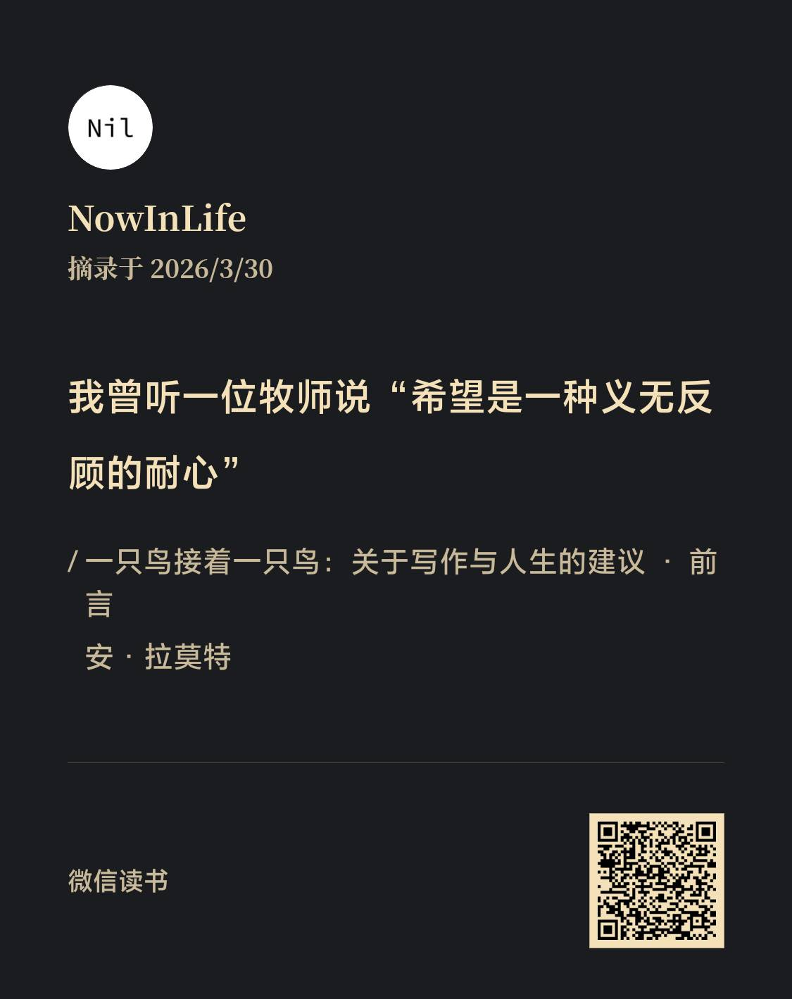

# 希望是一种义无反顾的耐心

希望是一种义无反顾的耐心， 正如此话出自一位牧师之口，宗教的虔诚信徒应该对此深有体会吧，宗教提供的终极目标如入极乐净土，入天堂或者羽化飞仙等等，对于深信的人而言就是希望，一个活着时无法验证真伪的希望，但是他们给以足够的耐心，虔诚修行、即便生活困顿也愿意捐献钱财修建起那一一座座富丽堂皇的教堂、寺庙、道观...

想到两句俗语，”临时抱佛脚“，”病急乱投医“，说起来有些可悲、有些无奈，面对显示生活中的无可奈何，出此下策，怀着一点点希望、侥幸，不信宗教的人求助于神佛，相信医学的人求助于神医偏方。面对最终破碎的希望，不知花出去的钱财，能否换来内心的一点安宁？

于我自己而言，这十多年来，人生一直在原地踏步，抱着侥幸的心态—万一明天变好了呢—凑合了一天又一天，足够有耐心了吧？明日复明日，当这个美丽的泡泡终有一天被戳破时，我又以何心态来回顾我的人生？